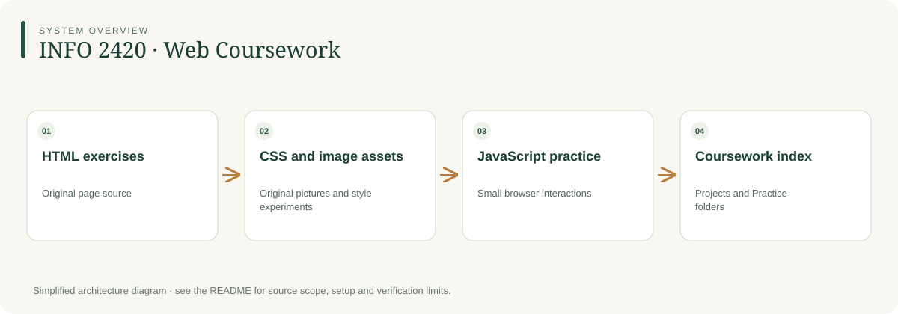

# INFO 2420 Web Coursework

HTML, CSS, image, and JavaScript exercises from my web course. This repository preserves learning history and original filenames.

- [Course index](index.html)
- [Project exercises](Projects/)
- [Practice examples](Practice/)
- [Original saved screenshot](Screenshot%202025-05-14%20130623.png)

## Preview

```sh
python3 -m http.server 8000
```

Open `http://localhost:8000`. There is no package install or build step.



The November 22 audit checked 228 local references across 57 HTML pages and found missing font/image targets and broken links. These are historical exercises, not a finished client application.
